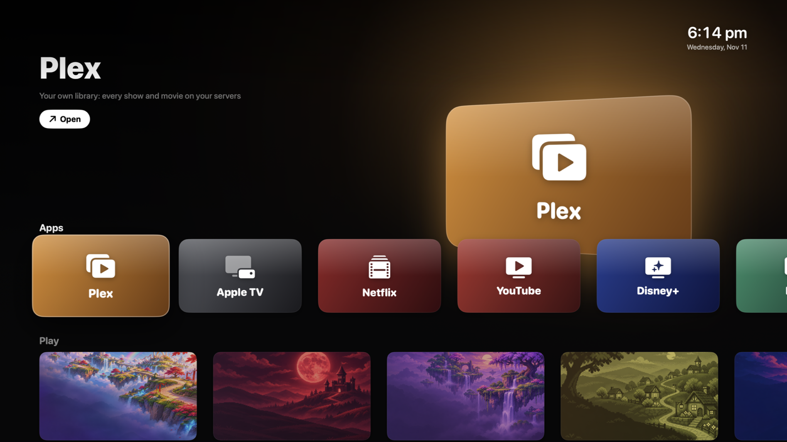
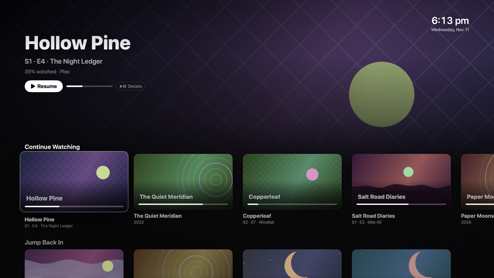
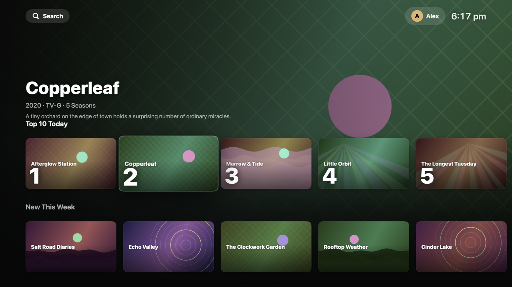
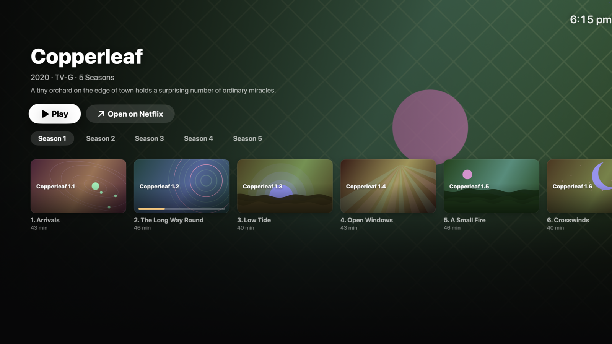
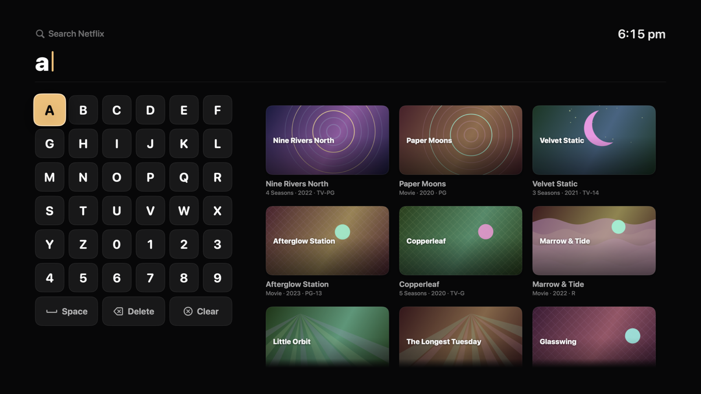
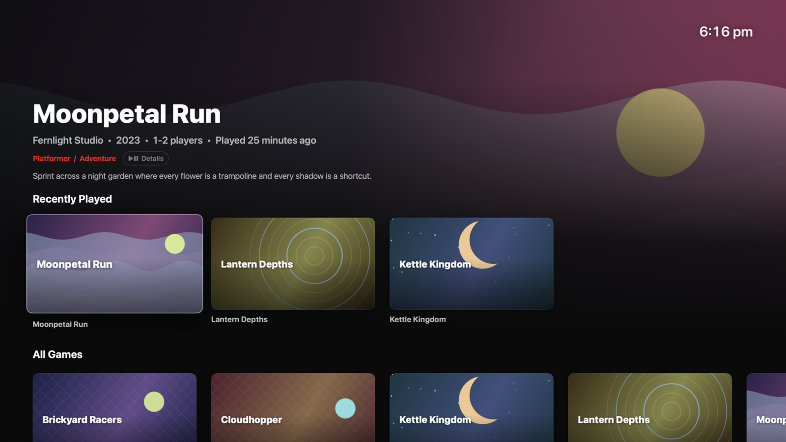
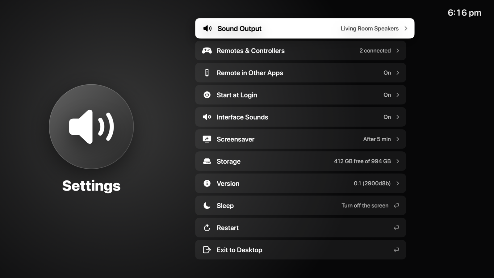

# CouchMode

A full-screen, remote- and controller-driven home screen for a Mac mini in a
living room. One calm screen for your streaming services, your Plex library,
your own Switch-format games and your retro consoles, with macOS hidden
underneath.

The goal is Apple TV-like simplicity on a Mac's power: pick up the remote,
see what you were watching or playing, press Select. No windows, no
cursor, no desktop. Because it is a real Mac underneath, it also runs
things a streaming box cannot: Plex's own TV app, RetroArch, and Switch
games built with the TVPort/NX2Apple engine.

Everything on the screens in this README is **invented sample content**
(see [Demo mode](#demo-mode)). No real viewing history, no real artwork.

## Screenshots

| | |
|---|---|
|  |  |
| **Home.** Apps and consoles; the focused item fills the screen behind a hero. | **Continue Watching.** Plex titles you are partway through, with progress. |
|  |  |
| **A service's home.** Rows and a featured title, drawn by CouchMode, filled from the signed-in site. | **Details.** Seasons and episodes for a show. |
|  |  |
| **Search.** An on-screen keyboard that works with a remote; results appear as you type. | **A console.** Recently played and all games, with details. |
|  | |
| **Settings.** Sound, controllers, start at login, screensaver, sleep, restart, exit. | |

## What it does

- **Streaming services:** Netflix, Hulu, YouTube, Disney+, Prime Video, Max
  and Apple TV, each a tile on Home.
- **Plex:** the tile opens the Plex HTPC app. A Continue Watching row on Home
  opens a title there directly, on its own page, ready to resume.
- **Games:** Switch games built with the TVPort/NX2Apple engine, and retro
  consoles through RetroArch (NES, SNES, N64, GameCube/Wii, Game Boy, DS,
  PlayStation, PS2, PSP, Master System, Genesis, Sega CD, Saturn, Dreamcast,
  TurboGrafx-16, Atari 2600, arcade). **CouchMode ships no games, no BIOS
  files and no emulator cores.** It lists and launches the files you put in
  `~/Games/`.
- **Settings:** sound output, remotes and controllers (pairing), start at
  login, screensaver, interface sounds, sleep, restart and exit to desktop.

## How it works

### Shared screens, one reader per service

Netflix, Hulu, Disney+ and Prime Video open in CouchMode's *own* TV screens: home rows with a
featured title, a details page with seasons and episodes, search with an
on-screen keyboard, and a profile picker. Those screens are the same for
every service (`StreamHomeView`, `StreamDetailView`, `StreamSearchView`),
and they only know a small, service-neutral vocabulary (`StreamHome`,
`StreamTitle`, `StreamTitleDetails`, in `StreamCatalog.swift`).

A small **reader** per service fills that vocabulary in. A reader is a
`StreamSource` (`StreamSource.swift`): `home()`, `details(for:)`,
`episodes(in:of:)`, `search(_:)`, `switchProfile(to:)`. `NetflixSource`,
`HuluSource`, `DisneySource` and `PrimeSource` are the real ones. The parsing of each site's page data is
pure code in `CouchModeCore` (`NetflixHome`, `HuluHome`, `DisneyHome`, `PrimeHome`, ...), tested against
synthetic fixtures. Services that don't have a reader open their website with
remote-friendly navigation instead.

### The proxy rule

A reader is a **proxy**. Each thing a person does on CouchMode's screen is
the *same single action* on the real, signed-in website, read back:
open the service, search, open a title, switch season, switch profile.
Nothing is crawled, nothing is fetched ahead, nothing is cached beyond the
current screen. The shared `PageDriver` runs one action at a time in the
service's own web page, the newest action wins, and every step has a time
limit.

### Backstage pages

Each service's website is kept alive in a web view *behind* the CouchMode
screen (the "backstage page"). That is how you stay signed in, how a reader
has a page to act on, and how the site's own player is ready when you press
Play. You never see the backstage page except while a title plays.

### Player handoff

Playback is never drawn by CouchMode. Pressing Play hands off to the
service's own web player, full screen, in its own page. CouchMode does not
touch video, does not touch DRM, and does not try to. **Back, Escape or
leaving the player** (the site's own back arrow, or the episode ending)
returns to the CouchMode screen you came from.

### Plex HTPC

The Plex tile launches the Plex HTPC app (the remote-friendly native Plex
client). CouchMode reads your Continue Watching from Plex using the
sign-in it finds in Plex Web inside CouchMode, keeps the token in this Mac's
Keychain, and opens a title in Plex HTPC on its own page. The details are in
`PlexHTPC.swift`.

### Games

Retro games are files in `~/Games/<console>/`; RetroArch plays them using
cores in RetroArch's own folder. Switch games are Mac apps in
`~/Games/switch/`, built with the TVPort/NX2Apple engine; CouchMode reads an
optional catalog file for their names and art. Pressing Home (the Siri
Remote's TV button, a held Back, the Home key or Command-Delete) always ends
at CouchMode: a retro game saves its state and quits, a Switch game is
paused and shown first under Jump Back In.

## Requirements

- A Mac with **Apple Silicon**, macOS 14 or later.
- Xcode (or the Swift 5.9+ toolchain) to build it. There is no download.
- Optional: Plex HTPC, RetroArch with cores, NX2Apple game builds, and your
  own accounts for the streaming services.
- Permissions macOS will ask for: Accessibility (so Home works from other
  apps and the remote can drive them); Screen Recording only if you enable
  the debug channel's screenshot route.

## Build, test, deploy

```
scripts/check.sh        # release build + all tests
scripts/build-app.sh    # dist/CouchMode.app
scripts/deploy.sh       # copy to the media Mac and relaunch it
```

Copy `scripts/local.env.example` to `scripts/local.env` (ignored by git)
and fill it in:

- `HTPC_HOST`: the ssh destination of the Mac that runs CouchMode, for
  `deploy.sh`. Key-based ssh must already work.
- `HTPC_SIGN_IDENTITY`: a code-signing identity from
  `security find-identity -v -p codesigning`. A stable identity keeps
  macOS's permission grants and Keychain access across rebuilds; without one
  the app is signed ad hoc and macOS asks again after each build.

More in [agents/build-test-deploy.md](agents/build-test-deploy.md).

## Using it

| Input | Does |
|---|---|
| Arrows / d-pad / left stick / remote touch surface | Move focus |
| Return / A / remote click | Select |
| Escape / B / remote Back | Back |
| `I` / remote Play-Pause | Details (on Home and game tiles) |
| Command-Delete, Home key, remote TV button, held Back or Menu | Home, from anywhere |

On a streaming site's own page (while a title plays) the real keys go to the
site's player; Back and Escape come back to CouchMode. Controllers need no
setup beyond pairing; Settings has a Remotes & Controllers page for pairing.

## Demo mode

Demo mode shows only invented titles with generated artwork, so
screenshots and trials contain no personal data and no one else's art. It
is off unless you turn it on:

```
defaults write local.brad.htpcshell DemoMode -bool true      # then relaunch
defaults delete local.brad.htpcshell DemoMode                # back to normal
```

In demo mode nothing is launched: no other app, no website, no player. See
[agents/demo-mode.md](agents/demo-mode.md). The screenshots above were
taken this way.

## Privacy

- **No telemetry.** CouchMode sends nothing about you anywhere.
- It talks only to the services you sign into (their websites, in their own
  web views) and to your own Plex servers, using the sign-in you gave those
  services. The Plex token is kept in this Mac's Keychain and is sent only to
  Plex.
- The optional debug channel is off by default and listens on 127.0.0.1 only.
- Logs never contain tokens.

## Limitations

- Only Netflix, Hulu, Disney+ and Prime Video have CouchMode's own screens; the others open
  their website. Readers depend on each site's page, which can change without
  notice.
- "More in a row" (reaching the end of a row loads the next batch, one request each
  time, up to 40 titles a row) works on Disney+ and Prime Video, using the same paging
  request each site's own page makes. Hulu's home already returns a row's first 50 titles,
  more than a row holds, so there is nothing further to load. Netflix pages its rows with a
  persisted GraphQL query whose id is not in the page's data, so its rows stay at what the
  home page loaded. On Disney+ only the first rows carry titles (as on the site, later
  shelves load as they are scrolled to) and the profile list comes from the top bar's
  menu, so profiles are named, not numbered, and a name two profiles share
  can't be chosen.
- Disney+ may show its own "update this profile" or PIN step when a profile is
  chosen; CouchMode doesn't fill those in, so that switch is reported as
  failed and the profile is finished on Disney+'s own page.
- Prime Video's player opens over the title's page rather than as a page of its
  own, so CouchMode asks the page once a second whether the player is showing to
  know when you have left it (other services are detected by their address).
  Prime's home and details pages autoplay trailers; turn off "Autoplay video and
  live events" in Prime Video's playback settings (it is per profile), otherwise
  a trailer is started in the page behind CouchMode's screens (kept silent while
  it is out of view). Next-episode autoplay is a separate setting and is left alone.
- Prime Video lists titles you must rent, buy or get through a channel: they
  appear with their art and details, and Play opens Prime's own page for them.
  A season's episodes come from the season's own page, one page of them (Prime
  pages long seasons); a profile's id is its name, and a PIN or profile form is
  finished on Prime's own page.
- Streaming picture quality is whatever each site gives a Mac web browser;
  for example some sites cap at a lower resolution than their TV apps.
- Switch games need NX2Apple builds you made yourself; retro games need
  RetroArch, its cores and (for some systems) BIOS files you provide.
- Not an App Store app; it is signed and run on your own Mac.
- Siri Remote and controller behavior was tested on a handful of devices.

## For AI coding agents

Start with [AGENTS.md](AGENTS.md): the ground rules, then an index into
[agents/](agents/).

## License

MIT. See [LICENSE](LICENSE).
